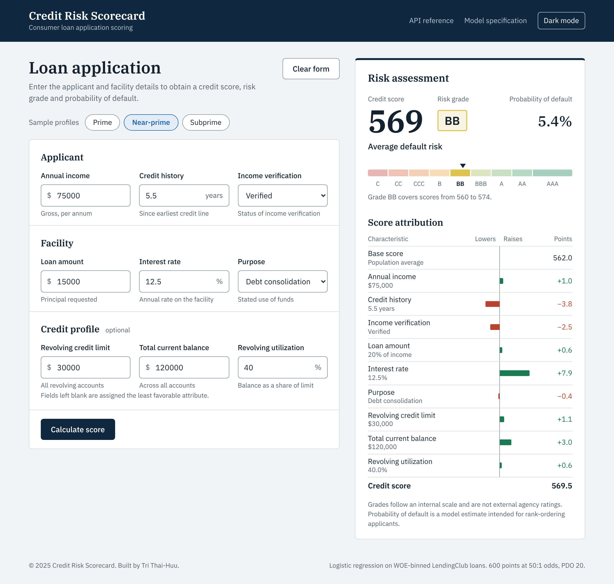
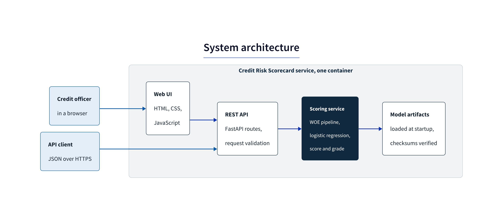

# Credit Risk Scorecard for Default Prediction

[](https://github.com/thaitri2005/Credit-Scorecard-for-Default-Prediction/actions/workflows/deploy.yml)
[](LICENSE)


A credit scoring service for consumer loans. Enter an application and it returns a credit score, a risk grade, a probability of default, and the points each characteristic added or removed.

**Live app:** <https://creditscorecardwoeiv-bgc3edb0fzgzdzfg.eastasia-01.azurewebsites.net/> (the first request can take up to a minute while the free tier wakes up)



The model is a logistic regression on Weight of Evidence (WOE) bins, trained on 872,666 LendingClub loans in my Kaggle notebook, [Credit Risk Scorecard for Default Prediction](https://www.kaggle.com/code/quangnguynngnht/credit-risk-scorecard-for-default-prediction). On the hold-out set it reached an AUC of 0.72 and a KS statistic of 0.33. This repository turns that model into a product: a REST API, a web UI, a Docker image, and a pipeline that tests, scans and deploys every change.

## How it works



One container serves both the web UI and the API. The scoring service loads the fitted pipeline and model once at startup, verifies them against recorded checksums, and scores each validated application.

- [Architecture](docs/architecture.md): components, the request path, and the release pipeline
- [Scoring](docs/scoring.md): how an application becomes a score, a grade and a points breakdown

## Run it

Locally, with Python 3.10:

```bash
git clone https://github.com/thaitri2005/Credit-Scorecard-for-Default-Prediction.git
cd Credit-Scorecard-for-Default-Prediction
python -m venv venv
source venv/bin/activate   # Windows: venv\Scripts\activate
pip install -r requirements-dev.txt
uvicorn app.main:app --reload
```

With Docker:

```bash
docker compose up --build
```

Or pull the published image:

```bash
docker run -p 8000:80 thaitri2005/credit_scorecard_for_default_prediction:latest
```

Each option serves the UI at <http://localhost:8000> and the interactive API reference at <http://localhost:8000/docs>.

## API

| Endpoint | Purpose |
|----------|---------|
| `POST /api/v1/predict` | Score one application |
| `POST /api/v1/predict/batch` | Score up to 1000 applications |
| `GET /api/v1/model/info` | Characteristics, scoring parameters and grade bands |
| `GET /api/v1/health` | Health check; `503` if the model is not loaded |
| `GET /info` | Service name, version and endpoints |

### Request fields

| Field | Required | Description |
|-------|----------|-------------|
| `annual_inc` | yes | Annual income in USD |
| `credit_history_length` | yes | Years since the first credit account |
| `verification_status` | yes | `Verified`, `Source Verified` or `Not Verified` |
| `loan_amount` | yes | Loan amount in USD |
| `int_rate` | yes | Interest rate in percent |
| `purpose` | yes | `debt_consolidation`, `credit_card`, `home_improvement`, `major_purchase`, `car`, `house`, `small_business`, `medical`, `moving`, `vacation`, `wedding`, `educational`, `renewable_energy` or `other` |
| `total_rev_hi_lim` | no | Total revolving credit limit in USD |
| `tot_cur_bal` | no | Total current balance in USD |
| `revol_util` | no | Revolving utilization in percent |

Callers that already have the ratio of loan amount to income can send `loan_burden` instead of `loan_amount`. An optional field left out is assigned its least favorable attribute and listed in `missing_fields`.

### Example

```bash
curl -X POST "http://localhost:8000/api/v1/predict" \
     -H "Content-Type: application/json" \
     -d '{
       "annual_inc": 75000,
       "credit_history_length": 5.5,
       "verification_status": "Verified",
       "loan_amount": 15000,
       "int_rate": 12.5,
       "purpose": "debt_consolidation",
       "total_rev_hi_lim": 30000,
       "tot_cur_bal": 120000,
       "revol_util": 40
     }'
```

```json
{
  "credit_score": 569.55,
  "default_probability": 0.0543,
  "risk_level": "BB",
  "risk_description": "Average default risk",
  "log_odds": -2.8568,
  "base_points": 562.01,
  "points": [
    {"feature": "int_rate", "points": 7.89},
    {"feature": "total_rev_hi_lim", "points": 1.15},
    {"feature": "tot_cur_bal", "points": 3.03},
    {"feature": "annual_inc", "points": 0.96},
    {"feature": "purpose", "points": -0.37},
    {"feature": "loan_burden", "points": 0.64},
    {"feature": "credit_history_length", "points": -3.77},
    {"feature": "revol_util", "points": 0.56},
    {"feature": "verification_status", "points": -2.54}
  ],
  "missing_fields": [],
  "message": "Average default risk"
}
```

## Risk grades

Scores from this model range from 511 to 646 and map to nine grades.

| Score | Grade | Meaning | Probability of default |
|-------|-------|---------|------------------------|
| 620 and above | AAA | Minimal default risk | under 1% |
| 605-619 | AA | Very low default risk | 1% - 1.7% |
| 590-604 | A | Low default risk | 1.7% - 2.8% |
| 575-589 | BBB | Below-average default risk | 2.8% - 4.5% |
| 560-574 | BB | Average default risk | 4.5% - 7.4% |
| 545-559 | B | Above-average default risk | 7.4% - 12% |
| 530-544 | CCC | High default risk | 12% - 18% |
| 515-529 | CC | Very high default risk | 18% - 28% |
| below 515 | C | Highest default risk this model assigns | above 28% |

The grades use a familiar letter scale but are internal to this model, not agency credit ratings. [Scoring](docs/scoring.md) explains the calculation.

## Project layout

```text
app/
  main.py                  App entrypoint, middleware, error handlers
  config.py                Version, logging, service metadata
  api/routes.py            Endpoints
  api/schemas.py           Request and response models
  scoring/service.py       Loads the model; scores, grades and attributes points
  scoring/transformers.py  Preprocessing steps of the fitted pipeline
  static/                  Web UI
models/                    Trained model, preprocessing pipeline, scorecard, metadata
notebooks/                 Training notebooks
docs/                      Architecture and scoring guides, diagrams
tests/                     API and scoring tests
.github/workflows/         CI/CD pipeline
```

## Development

```bash
pytest --cov=app
black --check .
flake8 . --max-line-length=100 --ignore=E203,W503
mypy . --ignore-missing-imports
```

scikit-learn, numpy and pandas are pinned to the versions the model was saved with; keep them in step with the files in `models/`.

## License

MIT. See [LICENSE](LICENSE).
