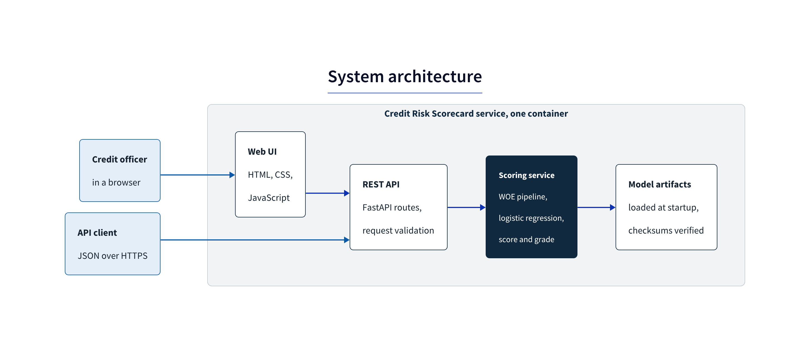
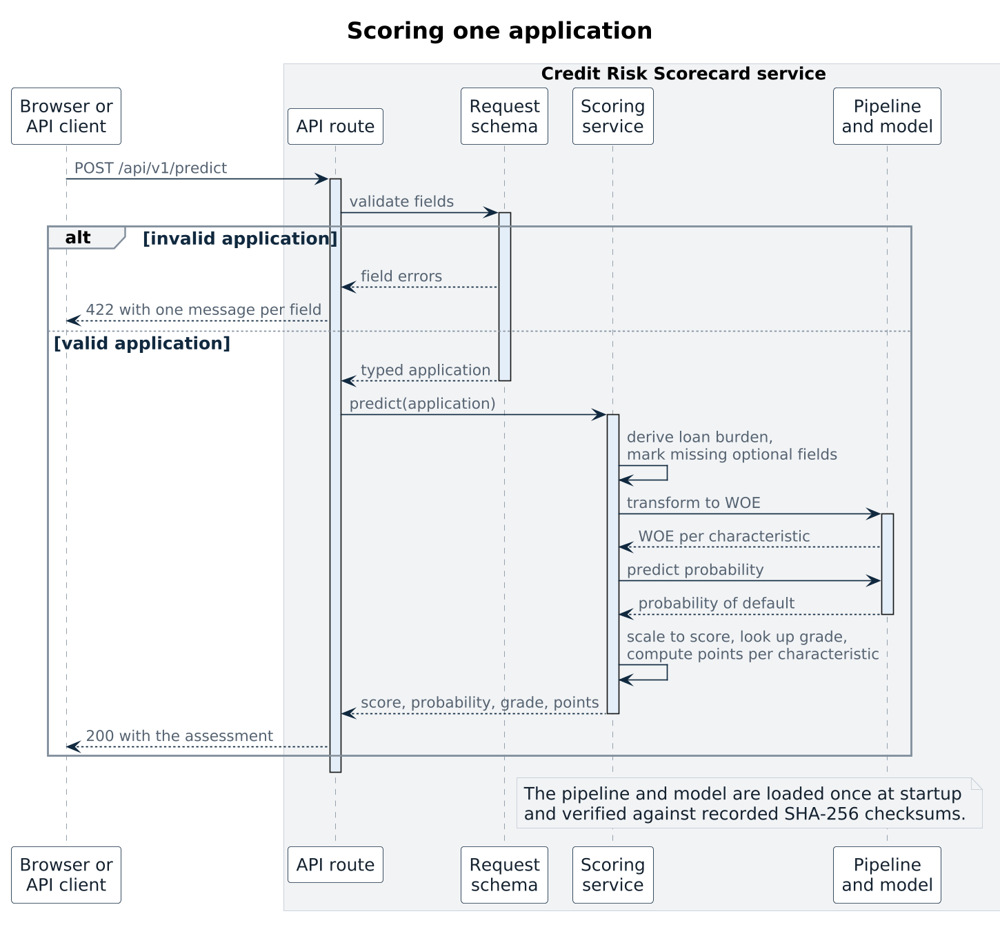
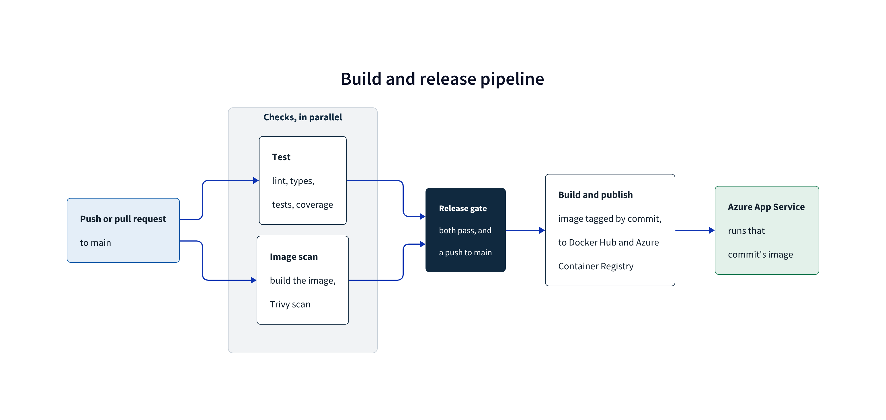

# Architecture

The service is a single container that serves a web UI and a REST API in front of one scoring service.

## Components

| Component | Code | Responsibility |
|-----------|------|----------------|
| Web UI | `app/static/` | A form for the application and a live assessment: score, grade scale and points per characteristic. Plain HTML, CSS and JavaScript with no build step. |
| REST API | `app/api/routes.py`, `app/api/schemas.py` | Endpoints and strict request validation. Unknown fields, non-numeric values and out-of-range values are rejected with a message per field. |
| Scoring service | `app/scoring/service.py` | Loads the artifacts, turns applications into WOE values, and returns the score, probability, grade and points. |
| Pipeline steps | `app/scoring/transformers.py` | The preprocessing classes the fitted pipeline was saved with. |
| Model artifacts | `models/` | The fitted pipeline, the logistic regression, the scorecard table, and metadata holding the scaling parameters, grade bands and checksums. |

## Scoring one application

A few choices shape this path:

- **The model loads once.** Startup loads the pipeline and model and verifies each file against the SHA-256 recorded in `models/model_metadata.json`. If that fails, `/api/v1/health` returns `503` and the container is reported unhealthy.
- **Validation happens at the edge.** The scoring service only ever sees typed, in-range applications, so a bad request never reaches the model.
- **Batches are scored in one pass.** `/api/v1/predict/batch` builds a single table from up to 1000 applications instead of scoring them one by one.
- **Scoring runs off the event loop.** Handlers are synchronous functions, so FastAPI runs the CPU-bound work in its thread pool and the service stays responsive.

## Build and release

Pushes and pull requests to `main` run the tests and an image scan in parallel. A push that passes both is built once, tagged with its commit SHA, published to Docker Hub and Azure Container Registry, and deployed to Azure App Service by that tag. Deploying an earlier tag rolls back.

The workflow is defined in [`.github/workflows/deploy.yml`](../.github/workflows/deploy.yml).

## Configuration

| Variable | Default | Effect |
|----------|---------|--------|
| `CORS_ORIGINS` | any origin | Comma-separated list of origins allowed to call the API from a browser |
| `ALLOWED_HOSTS` | any host | Comma-separated list of accepted `Host` headers; `localhost` is always accepted for the health check |
| `LOG_LEVEL` | `INFO` | Logging level |
| `DEBUG` | `false` | Include exception text in `500` responses |

## Diagrams

The diagram sources are in [`docs/diagrams/`](diagrams): `.d2` files rendered with [D2](https://d2lang.com) and a `.puml` file rendered with [PlantUML](https://plantuml.com). `_style.d2` holds the shared styles and is prepended to each `.d2` file before rendering.
