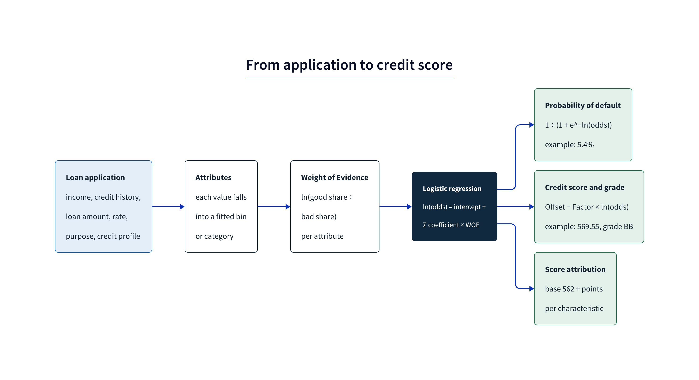

# Scoring

How a loan application becomes a credit score, a risk grade and a points breakdown.



## The model

A logistic regression over nine characteristics, each converted to its Weight of Evidence (WOE).

| | |
|---|---|
| Training data | 872,666 LendingClub loans, 7.0% of them bad |
| Split | 610,866 training, 261,800 hold-out |
| Hold-out AUC | 0.72 |
| Hold-out KS | 0.33 |

Numeric characteristics are cut into bins by a decision tree, and each bin or category is an *attribute* with its own WOE:

```text
WOE = ln(share of good loans in the attribute ÷ share of bad loans in the attribute)
```

A positive WOE means the attribute holds proportionally more good loans than the portfolio.

| Characteristic | Input | Attributes |
|----------------|-------|------------|
| Interest rate | `int_rate` | 5 bins |
| Annual income | `annual_inc` | 5 bins |
| Credit history length | `credit_history_length` | 5 bins |
| Loan burden | `loan_amount ÷ (annual_inc + 1)` | 5 bins |
| Revolving credit limit | `total_rev_hi_lim` | 4 bins |
| Total current balance | `tot_cur_bal` | 4 bins |
| Revolving utilization | `revol_util` | 5 bins |
| Purpose | `purpose` | 14 categories |
| Income verification | `verification_status` | 3 categories |

## From odds to score

The model gives the log-odds of default, which is scaled to a score:

```text
ln(odds of default) = intercept + Σ coefficient × WOE
Score  = Offset − Factor × ln(odds of default)
Factor = PDO ÷ ln(2)
Offset = BaseScore − Factor × ln(BaseOdds)
```

With PDO = 20, BaseScore = 600 and BaseOdds = 50:1, a score of 600 means 50:1 odds of repaying and every 20 points doubles those odds.

## Points per characteristic

Because the score is linear in the WOE values, it splits exactly into a base score and one term per characteristic:

```text
Base score = Offset − Factor × intercept          = 562.01
Points     = −Factor × coefficient × WOE          for each characteristic
```

The base score is what an applicant with average evidence on every characteristic receives. For the example in the [README](../README.md#example):

| Characteristic | Attribute | Points |
|----------------|-----------|-------:|
| Base score | | 562.01 |
| Interest rate | 12.5% | +7.89 |
| Total current balance | $120,000 | +3.03 |
| Revolving credit limit | $30,000 | +1.15 |
| Annual income | $75,000 | +0.96 |
| Loan burden | 20% of income | +0.64 |
| Revolving utilization | 40% | +0.56 |
| Purpose | Debt consolidation | −0.37 |
| Income verification | Verified | −2.54 |
| Credit history length | 5.5 years | −3.77 |
| **Credit score** | | **569.55** |

The API returns these as `base_points` and `points`, and the web UI draws them as the score attribution chart. `models/scorecard.csv` lists the bins and their points.

## Risk grades

Scores range from 511 to 646. Grades are 15-point bands across that range; the full table is in the [README](../README.md#risk-grades). They are internal to this model and are not agency credit ratings.

## Missing values

Revolving credit limit, total current balance and revolving utilization are optional. A missing value is assigned the least favorable attribute of that characteristic, so leaving a field blank never scores better than filling it in. The response lists these fields in `missing_fields`.

## Changing the scale or the grades

The scaling parameters (`PDO`, `BaseScore`, `BaseOdds`) and the grade bands (`rating_bands`) are read from `models/model_metadata.json` at startup, so they can be changed without touching code.
